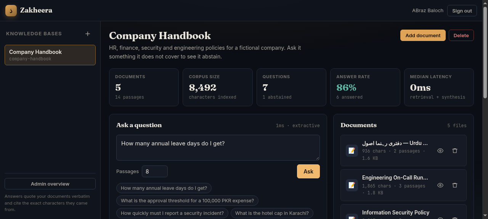
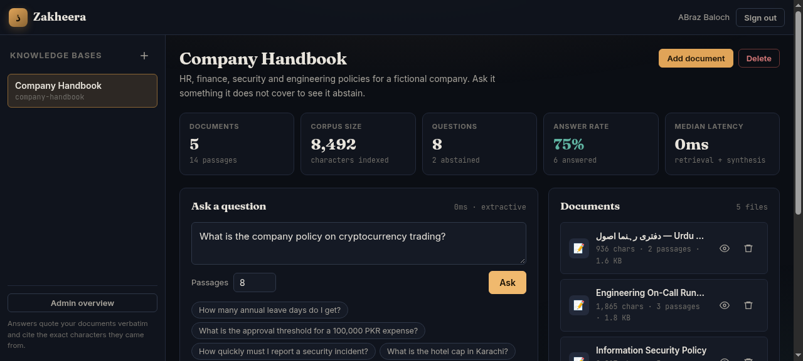

# Zakheera

**A knowledge base that cites its sources — and tells you when it doesn't know.**

Zakheera (ذخیرہ — "archive", "store") is a retrieval-augmented question
answering system over your own documents. Upload a policy, a handbook, a spec,
a set of meeting notes. Ask questions in English or Urdu. Get answers assembled
from the documents themselves, with the exact character range each sentence
came from.

The thing that makes it different: **it abstains.** Ask something your
documents don't cover and it says so, names the terms it couldn't find, and
shows you the coverage score. It does not invent an answer.



---

## Why abstention is the whole point

Every RAG demo answers every question. That is the problem. If a system always
produces a confident paragraph, you have no way to tell a right answer from a
plausible one — and the plausible one is exactly the one that gets pasted into
a client email.

Zakheera computes **corpus coverage** before it answers: the IDF-weighted share
of your question's terms that appear anywhere in the corpus. Below the
threshold, it abstains and tells you what was missing.



> **Q:** What is the company policy on cryptocurrency trading?
>
> **Abstained.** Only 35% of this question's meaningful terms appear anywhere in
> the corpus (the threshold is 50%). Not found: `cryptocurrency`, `trade`. This
> knowledge base does not appear to cover it.

That is a more useful answer than a paragraph about the expense policy.

---

## Features

**Retrieval**
- Hybrid search — BM25 lexical ranking fused with TF-IDF cosine similarity via
  Reciprocal Rank Fusion, so neither ranker's scale can dominate
- Character-offset citations — every quote is `source[start:end]`, verifiable
  by hand
- IDF-weighted abstention with the missing terms named
- Bilingual tokenisation — English stemming that leaves Urdu alone
- Overlapping chunks with exact-slice guarantees

**Ingestion**
- Upload `.txt`, `.md`, `.pdf`, `.docx` (tables included) or paste text
- Per-document preview, chunk count and character count
- Honest warnings — a scanned PDF with no text layer says OCR is needed rather
  than indexing nothing

**Product**
- Workspaces — one topic per knowledge base retrieves better than one pile
- Live stats — answer rate, abstention count, median latency
- Admin overview — platform counters and the most-asked questions
- Mobile-first responsive UI, no build step

**Engineering**
- 186 tests, ruff clean, formatted
- JWT auth with bcrypt; ownership checks return 404 not 403
- Rate limiting, security headers, escaped rendering
- Docker + docker-compose with PostgreSQL; SQLite fallback for local dev

---

## Quick start

```bash
git clone https://github.com/mohdabrarbaloch-arch/day-30-zakheera.git
cd day-30-zakheera

python -m venv .venv && source .venv/bin/activate
pip install -r requirements.txt

cp .env.example .env
python -c "import secrets; print('SECRET_KEY=' + secrets.token_urlsafe(48))" >> .env

python -m scripts.seed          # demo account + a 5-document corpus
uvicorn app.main:app --reload
```

Open **http://127.0.0.1:8000** and sign in:

```
email:    abraz@example.com
password: zakheera-demo-2026
```

The seed creates a fictional company handbook — leave, expenses, security,
on-call, and an Urdu summary — so you can try it immediately. Ask it something
it doesn't cover to watch it abstain.

### With Docker

```bash
export SECRET_KEY=$(python -c "import secrets; print(secrets.token_urlsafe(48))")
docker compose up --build
```

Brings up PostgreSQL and the app together. The app waits for the database to be
healthy before starting.

---

## Try these

Against the seeded handbook:

| Question | What happens |
|---|---|
| How many annual leave days do I get? | Answers, cites 3 sentences with offsets |
| What is the approval threshold for a 100,000 PKR expense? | Answers with the approval table |
| How quickly must I report a security incident? | Answers, cites the security policy |
| What is the hotel cap in Karachi? | Answers with the exact figure |
| What is the company policy on cryptocurrency trading? | **Abstains**, names the missing terms |
| چھٹی کتنے دن ملتی ہے؟ | Answers in Urdu from the Urdu document |

---

## How it works

```
document → extract → tokenise → chunk → index ─┐
                                               │
question → tokenise ──────────────────────────►├─► BM25  ─┐
                                               │           ├─► RRF ─► synthesise ─► answer + citations
                                               └─► TF-IDF ─┘
```

1. **Extract** — file to plain text, with a warning if there is nothing to read
2. **Chunk** — overlapping spans, each an exact slice of the source
3. **Index** — an inverted index for BM25 and L2-normalised TF-IDF vectors
4. **Retrieve** — both rankers, fused by rank (not score) with RRF
5. **Synthesise** — quote the sentences that actually answer the question, each
   with its character range

Full reasoning, including the bugs found along the way, is in
[ARCHITECTURE.md](ARCHITECTURE.md).

---

## API

| Method | Path | Purpose |
|---|---|---|
| `POST` | `/api/auth/register` | Create an account (first user becomes admin) |
| `POST` | `/api/auth/login` | Get a JWT |
| `GET` | `/api/auth/me` | Current user |
| `GET` | `/api/workspaces` | List your knowledge bases |
| `POST` | `/api/workspaces` | Create one |
| `GET` | `/api/workspaces/{id}/stats` | Documents, chunks, answer rate, latency |
| `POST` | `/api/workspaces/{id}/documents/upload` | Upload a file |
| `POST` | `/api/workspaces/{id}/documents/text` | Paste text |
| `GET` | `/api/workspaces/{id}/documents` | List documents |
| `GET` | `/api/workspaces/{id}/documents/{doc_id}` | Preview one |
| `DELETE` | `/api/workspaces/{id}/documents/{doc_id}` | Remove one |
| `POST` | `/api/workspaces/{id}/query` | **Ask a question** |
| `GET` | `/api/workspaces/{id}/questions` | Question history |
| `GET` | `/api/admin/stats` | Platform counters (admin only) |
| `GET` | `/api/health` | Liveness |

Interactive docs at `/docs` once running. Full reference in
[docs/API.md](docs/API.md).

### Asking a question

```bash
curl -X POST http://127.0.0.1:8000/api/workspaces/1/query \
  -H "Authorization: Bearer $TOKEN" \
  -H "Content-Type: application/json" \
  -d '{"question": "How many annual leave days do I get?"}'
```

```json
{
  "answered": true,
  "answer": "Every full-time employee is entitled to twenty-four paid annual leave days per calendar year. [1]",
  "citations": [
    {
      "marker": 1,
      "document_title": "Employee Handbook — Leave and Attendance",
      "start_char": 48,
      "end_char": 141,
      "quote": "Every full-time employee is entitled to twenty-four paid annual leave days per calendar year."
    }
  ],
  "coverage": 1.0,
  "coverage_threshold": 0.5,
  "missing_terms": [],
  "latency_ms": 6
}
```

Verify the citation yourself:

```python
document[48:141] == citation["quote"]   # True
```

---

## Configuration

Every variable is documented in [.env.example](.env.example). The ones that
matter:

| Variable | Default | Notes |
|---|---|---|
| `SECRET_KEY` | — | **Required in production.** The app refuses to start without it. |
| `DATABASE_URL` | `sqlite:///./zakheera.db` | Postgres in Docker |
| `ABSTAIN_COVERAGE_THRESHOLD` | `0.5` | Lower = answers more, risks more wrong answers |
| `CHUNK_TARGET_CHARS` | `900` | Chunk size |
| `CHUNK_OVERLAP_CHARS` | `150` | Overlap between chunks |
| `RATE_LIMIT_PER_MINUTE` | `60` | Per client IP |
| `ACCESS_TOKEN_EXPIRE_MINUTES` | `1440` | 24 hours |

---

## Development

```bash
pip install -r requirements-dev.txt

pytest                      # 186 tests, ~15s, no network
ruff check .                # lint
ruff format --check .       # formatting
```

The RAG engine is pure functions over dataclasses with no database or I/O,
which is why the whole suite runs in seconds without a database.

---

## Known limitations

Stated plainly, because a tool that hides its limits is not trustworthy:

- **Lexical retrieval only.** It matches words, not meanings. "How long is the
  refund window?" against a policy that says "within thirty days of delivery"
  will abstain, because "window" never appears. A dense embedding model would
  handle that; TF-IDF cannot. The trade-off is deliberate — lexical failures
  are visible, dense failures are confident and wrong.
- **No migrations.** Tables are created on startup via `create_all()`. Fine for
  this scope, not for schema evolution. Alembic is the next step.
- **Rate limiting is per-process.** N workers = N× the limit. Redis is the fix.
- **The index is in memory.** Rebuilt per process on first query. Fine to a few
  thousand chunks; pgvector beyond that.
- **Ingest is synchronous.** A very large PDF blocks the request. A background
  queue is the fix.
- **No OCR.** A scanned PDF with no text layer is rejected with a warning
  rather than silently indexing nothing.

---

## License

MIT — see [LICENSE](LICENSE).

---

Built as Day 30 of a 30-day AI engineering challenge — the last one, and the
one I most wanted to get right.
